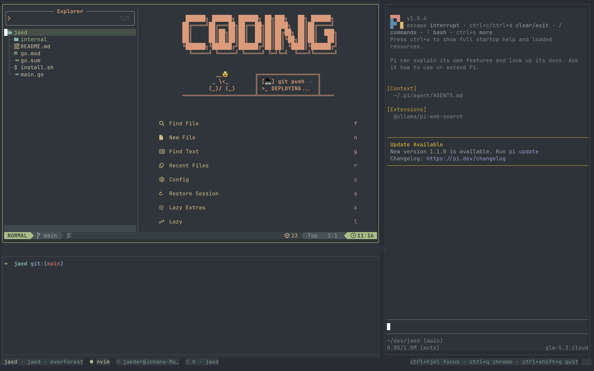

# jaed — an AI workspace TUI



An editor, a terminal, and a bring-your-own agent side panel, composed as
embedded terminal panes in one Bubble Tea TUI. The host terminal (Ghostty)
does the rendering; `jaed` is just text.

```
 sys cpu 12%  ·  ram 5.1G/8.0G  ·  net ↓1.2M/s ↑300K/s
┌──────────────────┬───────────┐
│  nvim             │  agent    │
│                   │  (pi)     │
├──────────────────┤           │
│  terminal         │           │
└──────────────────┴───────────┘
 jaed · chess · everforest  ● nvim  ○ zsh  ● pi      ctrl+hjkl focus · ctrl+q chrome
```

The `sys` line is the resource bar: whole-machine CPU, memory, and
network throughput, on by default and toggled from settings (`ctrl+q`
`S` → `cpu/ram/net`). It samples every 3s (macOS via `top`/`vm_stat`/
`netstat`, Linux via `/proc`).

## Install

```sh
./install.sh              # builds and installs to ~/.local/bin
./install.sh --uninstall   # removes it
```

The installer wires `~/.local/bin` into your PATH for zsh, bash, and
fish — appending a guarded export to each existing rc file, never
duplicating lines. Re-run it after pulling changes to rebuild.
Restart your terminal (or `source ~/.zshrc`) once.

## Usage

```sh
jaed                         # workspace in the current directory
jaed ~/dev/chess             # a project directory
jaed -a opencode ~/dev/chess # bring your own agent
jaed --theme everforest ~/dev/chess
```

## Keys

| Key | Mode | Effect |
|---|---|---|
| `ctrl+h/j/k/l` | anywhere | switch pane focus |
| `ctrl+shift+q` | anywhere | quit |
| anything else (focused pane) | pane | goes to the pane's process |
| `ctrl+q` | pane | release the pane → chrome mode |
| `ctrl+t` | anywhere | new shell tab |
| `ctrl+pgup/pgdn` · `ctrl+shift+[`/`]` | terminal | previous · next tab |
| `ctrl+w` · `ctrl+shift+w` | terminal | close the tab (hides the pane if it was the last) |
| `h/j/k/l` or arrows | chrome | focus panes |
| `t` | chrome | hide/show the terminal pane (process keeps running) |
| `a` | chrome | hide/show the agent pane (process keeps running) |
| `s` | chrome | agent picker popup |
| `S` | chrome | settings (theme, default agent) |
| `g` | chrome | fullscreen git view (panes keep running) |
| `T` | chrome | fullscreen tools view (agent scripts) |
| `c` | chrome | push the editor's active file to the agent pane |
| `H/J/K/L` | chrome | resize the grid (agent width / terminal height) |
| `Q` | chrome | quit (always works; legacy terminals can't report `ctrl+shift+q`) |
| `j/k` · enter · esc | picker | move · swap agent · close |
| `j/k` · enter · esc | settings | move · apply (live + persisted) · close |
| `j/k` · `ctrl+d/u` · `r` · `g`/`esc` | git | file · scroll diff · refresh · close |
| `j/k` · `ctrl+d/u` · `r` · `T`/`esc` | tools | tool · scroll code · rescan · close |

The git view shows changed files grouped **staged / unstaged /
untracked**, the selected file's diff colored to the theme, and the
branch in its header. `Q` quits from there too.

### Terminal tabs

The terminal pane is tabbed. `ctrl+t` opens a shell tab in the
workspace root next to the active one — from any pane — and
`ctrl+pgup`/`ctrl+pgdn` (or `ctrl+shift+[`/`]`) switch, and `ctrl+w`
closes. Multiple tabs share the pane's box; only the active one is
drawn, and the others keep running in the background. When more than one
tab is open the pane's top border becomes a tab strip and the status bar
shows `n/total`. Switching and closing are consumed only while the
terminal is focused, so the editor keeps its own `ctrl+w`. Closing the
last tab hides the terminal pane (`t` shows it again with a fresh
shell); a tab that dies within 3s of opening is crashing and is marked
`✕`, like any other pane.

## Editor ↔ agent

jaed starts nvim with a titlestring of `expand("%:p")`, so the pane's
terminal title always names the file being edited (bonus: your
terminal tab shows it too). `ctrl+q` then `c` pushes that file to the
agent pane: jaed types an `@/abs/path/to/file ` mention into the
agent's input and focuses it, so the next keystrokes finish your
prompt — "review the error handling" — and pi (or opencode) attaches
the file as context. No file open, agent hidden, or agent dead: `c`
degrades gracefully.

### Live awareness

With the optional pi extension, the agent is *passively* aware: jaed
continuously publishes the active buffer to
`$TMPDIR/jaed-active-<hash-of-workspace>`, and the extension injects
it as a system-prompt section on every prompt plus a
`jaed_active_file` tool the model can call anytime. Install (manual,
one time):

```sh
mkdir -p ~/.pi/agent/extensions
cp assets/jaed.ts ~/.pi/agent/extensions/jaed.ts
```

pi announces `jaed link: editing <path>` when it starts inside a
jaed workspace, and stays inert when run standalone.

opencode gets the same awareness through its V2 plugin API
(`assets/jaed-opencode.ts`, for opencode >= 2.0 — injects the active
file as a live system line on every model call plus the same tool).
Install (manual, one time):

```sh
mkdir -p ~/.config/opencode/plugins
cp assets/jaed-opencode.ts ~/.config/opencode/plugins/jaed.ts
```

Hidden panes show as `◇` in the status bar. Hiding the focused pane
releases focus to chrome mode; hidden panes keep running and re-layout
when shown again. Hide both for a fullscreen editor; `t`/`a` bring the
workspace back.

Panes whose process exits (e.g. `:q` in nvim) respawn with the original
command; a pane that dies within 3s of its own spawn is marked `✕ exited`
instead of looping.

The status bar shows each pane's live guest title (nvim names the file it
edits; pi sets `π - workspace`). The agent picker swaps the agent pane's
process live — `ctrl+q` `s` `j/k` `enter` — without leaving the session.

## Settings

`ctrl+q` then `S` opens the settings popup: theme (everforest,
catppuccin, gruvbox, tokyonight — applied live), the default agent
(swaps the live pane and future launches), and the `cpu/ram/net` resource
bar. Changes persist to `~/.config/jaed/settings.json` immediately; `-a`
and `--theme` flags override the saved defaults when passed.

## Bring your own agent

Builtin registry: `pi` (default), `opencode`, `shell`. Add your own in
`~/.config/jaed/agents.conf`:

```
# name = command [args...]
claude = /usr/local/bin/claude
aider = aider --model sonnet
```

They appear in the picker and in `-a`.

## Agent tools

jaed gives the agent a personal, sandboxed place to keep reusable
JavaScript tools. On startup it creates `.jaed/` in the workspace —
`tools/`, `skills/`, and a writable `tmp/` — and adds it to the
repository's local `.git/info/exclude`, so it is never committed.

The installed agent integration (see below) exposes three tools:
`jaed_tools_list`, `jaed_tools_write`, and `jaed_tools_run`, plus
`jaed_skills_read`/`jaed_skills_write` for longer reference material.
Ask the agent for a task it might want to repeat and it can write a tool
and run it from the chat.

`ctrl+q` then `T` opens the tools view: the workspace's scripts on the
left with their descriptions, the selected tool's source on the right.
Read-only — the tools are for the agent to run.

### The sandbox

Tools are ESM files exporting `default async function run(input, jaed)`,
run by Node under the permission model:

- no network, no child processes, no worker threads;
- read access to the workspace and the runtime only;
- write access to `.jaed/tmp` only;
- a 30-second timeout and a 256 MB heap cap;
- imports restricted to `node:` builtins (minus the capability modules),
  a small allowlist — `zod`, `yaml`, `date-fns`, `nanoid`, `marked`,
  `lodash-es` — and the injected `jaed` helper.

The runtime lives at `assets/jaed-tools/` and is installed to
`~/.config/jaed/runtime/` by `install.sh`, which also `npm install`s the
allowlist and copies the skill. Tools still work with only Node's
builtins if npm is unavailable.

## Layout

```
main.go                   entry: dir, --theme, -a agent, --editor
assets/jaed-tools/        sandboxed tool runtime: runner, loader, helper
internal/agents/          BYO agent registry (pi, opencode, shell)
internal/git/             repository state via the git CLI
internal/pane/            raw-PTY terminal (spanreed + windrunner)
internal/stats/           CPU/memory/network sampling (top+vm_stat+netstat / /proc)
internal/theme/           semantic palette + everforest
internal/tools/           .jaed discovery + local git exclude
internal/workspace/       grid layout, focus graph, respawn, status bar,
                          resource bar, agent picker, git view, tools view,
                          terminal tabs
```

Guests run with `TERM=xterm-256color` on raw PTYs and inherit your
environment. Panes paint their own everforest background, so the
workspace looks identical in any host terminal. pi's `system` theme
queries the pane's terminal and adapts automatically.

## Roadmap

- **M4** native file-tree pane, project tabs, more themes (catppuccin,
  gruvbox, tokyonight), auto theme from nvim; deeper pi state via RPC

## Stack

[Bubble Tea v2](https://charm.land) · [spanreed](https://github.com/trentkm/spanreed)
(embeddable terminal, VT emulation via `charmbracelet/x/vt`, PTY via
`windrunner`/`creack/pty`) · lipgloss for chrome.